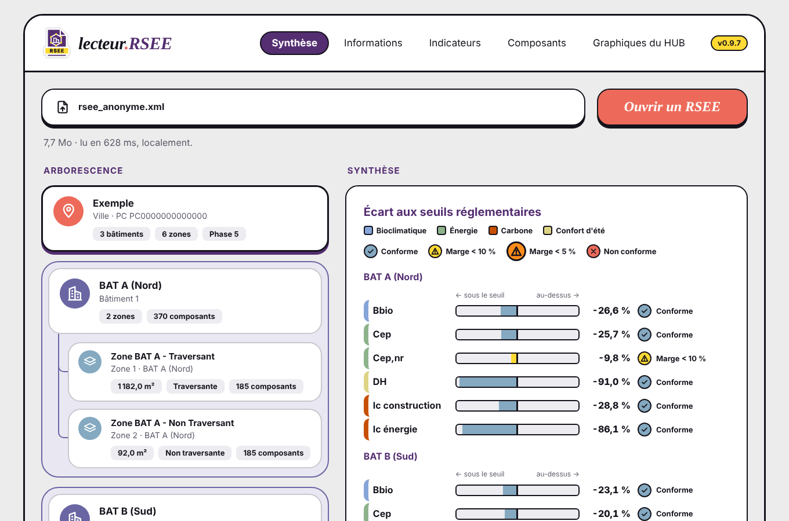
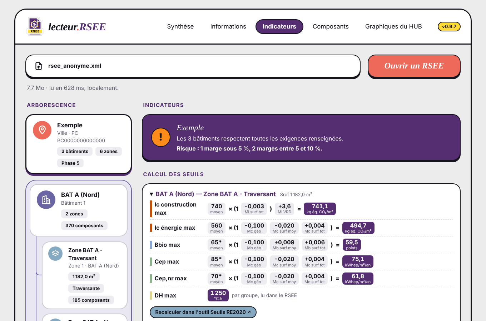
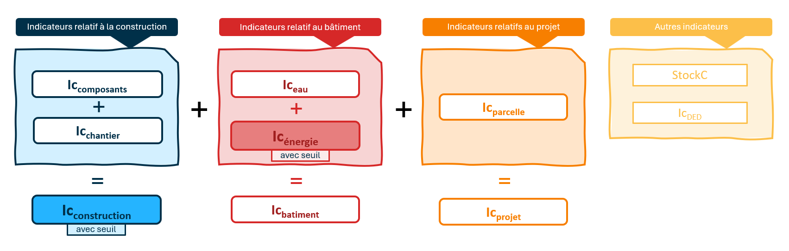
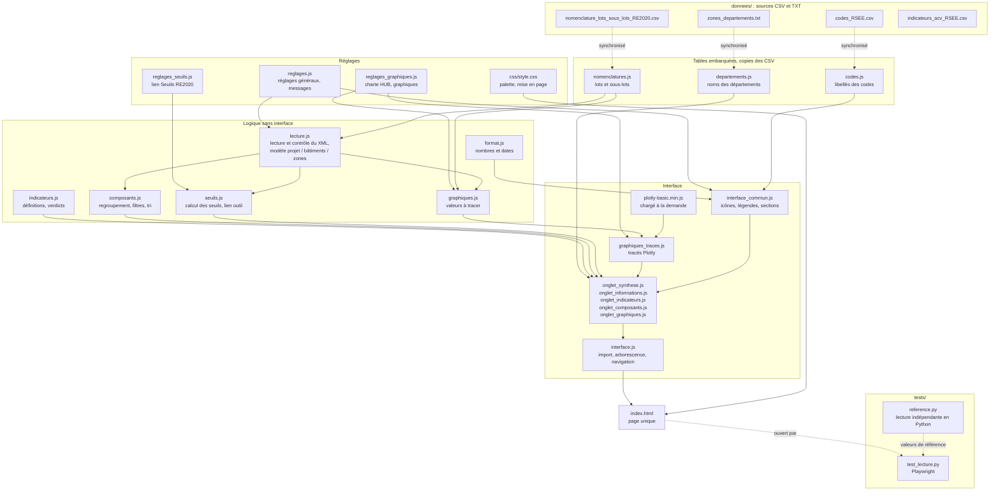

# lecteur_RSEE

Lecture seule d'un RSEE RE2020 (fichier XML) dans le navigateur.

**Outil en ligne : https://alliages.github.io/lecteur_RSEE/**



*Capture réalisée avec un RSEE anonymisé (noms, adresses, SIRET et permis remplacés).*

- [Pour les utilisateurs](#pour-les-utilisateurs) : ouvrir un RSEE et lire les résultats
- [Détails techniques](#détails-techniques) : organisation du code, tests, contribution

---

# Pour les utilisateurs

## Ce que fait l'outil

Un RSEE (rapport de synthèse d'étude énergie-environnement) est un fichier XML volumineux produit par
les logiciels de calcul RE2020. Le lecteur le rend lisible : arborescence projet / bâtiments / zones /
parcelle, indicateurs face aux seuils, composants, graphiques.

- **Aucun recalcul réglementaire** : l'outil affiche les valeurs contenues dans le RSEE. Un indicateur est
  déclaré conforme quand sa valeur est inférieure ou égale à son seuil, tous deux lus dans le fichier.
- **Traitement 100 % local** : le fichier ne quitte pas votre poste. La page interdit elle-même toute
  connexion (politique de sécurité du navigateur). Seuls deux liens, sur clic de votre part, ouvrent un site
  externe : l'outil [Seuils RE2020](https://seuils-re2020.streamlit.app/) (données techniques, sans nom ni
  adresse) et OpenStreetMap (coordonnées GPS du projet).
- **Rien à installer** : une page web, qui fonctionne aussi hors ligne (double-clic sur `index.html`).

## Utilisation

1. Ouvrir https://alliages.github.io/lecteur_RSEE/.
2. Cliquer sur **Ouvrir un RSEE**, ou glisser le fichier `.xml` sur la page.
3. Dans l'**arborescence** à gauche, choisir le projet, un bâtiment, une zone ou la parcelle.
4. Lire le détail du nœud choisi à droite, et changer d'**onglet** en haut pour une autre lecture du même nœud.

Le fichier doit être un RSEE au format XML. Une archive `.zip` est refusée (la décompresser d'abord), ainsi
qu'un XML qui n'est pas un RSEE : un message explique le problème.

Un **RSET seul** (partie thermique, sans partie environnementale) est aussi lu, avec le même affichage :
bâtiments et zones viennent du RSET, avec Bbio, Cep, Cep,nr et DH ; Ic, composants, services et parcelle
restent « non renseigné ». Le contrôle du fichier (Synthèse du projet) le signale, et indique à quelle zone
chaque groupe DH a été rattaché, d'après la structure du RSET, à vérifier.

## Les onglets

| Onglet | Ce qu'on y lit |
|---|---|
| **Synthèse** | Carte du nœud (surface, nombre de composants…) et écart de chaque exigence à son seuil : Bbio, Cep, Cep,nr, DH, Ic construction, Ic énergie. Un pictogramme indique conforme, marge < 10 %, marge < 5 % ou non conforme. |
| **Informations** | Opération (n° de permis, dates, avancement), localisation (zone climatique, altitude, zone sismique, sol, carte), acteurs (maîtrise d'ouvrage et d'œuvre, bureaux d'études), bâtiments, zones (usage, Sref, logements, niveaux, ascenseurs) et parcelle. |
| **Indicateurs** | Exigences par famille (bioclimatique, énergie, carbone, confort d'été), calcul détaillé des seuils (coefficients de modulation), consommation d'énergie finale par poste (somme = Cef, mobilier pour information), heures d'inconfort, risques, et composition de l'Ic. |
| **Composants** | Impacts par lot et sous-lot, puis tableau de tous les composants et services : fiche, type de donnée, quantité, unité, DVE. Recherche, filtres (contributeur, lot, type de fiche) et tri par colonne. Identifiants INIES en lien vers base-inies.fr. |
| **Graphiques du HUB** | Graphiques aux couleurs du [HUB des prescripteurs bas carbone](https://www.ifpeb.fr/travaux/le-hub-des-prescripteurs-bas-carbone/) appliqués au bâtiment ouvert : impact par contributeur et par lot, sous-lots les plus impactants, écarts aux seuils, fiches par type et par nature, stock de carbone face au label biosourcé. Chaque graphique a son tableau de données (« Voir les données »). |



## Comprendre les indicateurs

L'onglet Indicateurs reprend la logique de la RE2020 : l'impact carbone se construit par blocs qui
s'additionnent. Le schéma ci-dessous la résume ; seuls l'Ic construction et l'Ic énergie ont un seuil.



- **Ic construction** = Ic composants + Ic chantier (relatifs à la construction, avec seuil).
- **Ic bâtiment** = Ic construction + Ic eau + Ic énergie (relatifs au bâtiment ; l'Ic énergie a un seuil).
- **Ic projet** = Ic bâtiment + Ic parcelle (relatifs au projet).
- **Autres indicateurs** : StockC (stock de carbone) et Ic DED.

L'onglet Indicateurs affiche ces totaux, vérifie que chaque somme tombe juste (hors arrondis) et le signale
sinon. Les couleurs distinguent les familles d'exigences : bioclimatique (bleu), énergie (vert), carbone
(orange), confort d'été (jaune).

Les libellés de codes déduits d'un corpus de RSEE, et non d'une documentation officielle, portent une
infobulle « à valider » ; le code est toujours affiché à côté du libellé.

## Confidentialité

Un RSEE contient des données nominatives (noms, SIRET, adresses). Il n'est jamais enregistré ni envoyé, et
**aucun RSEE ne doit être ajouté à ce dépôt**, même anonymisé : le `.gitignore` exclut `*.xml`, `*.zip`
et `*.pdf`.

## Version et suivi

Version courante : voir [VERSION](VERSION) (0.9.x, outil fonctionnel). Historique dans
[CHANGELOG.md](CHANGELOG.md), évolutions prévues dans [ROADMAP.md](ROADMAP.md).

---

# Détails techniques

## Principes

- Une page HTML, des scripts classiques (pas de modules ni de compilation) et une feuille de style.
- Seule dépendance : Plotly.js basic 2.35.2 (licence MIT), copié dans `js/` et chargé à la première
  ouverture de l'onglet Graphiques.
- Sécurité : `index.html` impose une politique CSP (`default-src 'none'`, `connect-src 'none'`) ; les
  textes issus du RSEE sont insérés avec `textContent`, jamais en HTML, et nettoyés avant d'entrer dans un
  graphique : un fichier ne peut ni envoyer de données ni injecter de code.
- Séparation nette : les fichiers « sans interface » (lecture, calculs, formats) ne touchent pas au DOM et
  sont testables seuls ; les fichiers d'interface ne font que les afficher.

## Organigramme des fichiers

Les flèches vont d'un fichier vers ceux qui l'utilisent. `index.html` charge les scripts dans l'ordre
des couches ci-dessous.



## Rôle de chaque fichier

| Fichier | Rôle |
|---|---|
| `index.html` | Page unique : en-tête et onglets, zone d'import, arborescence, détail, pied de page ; charge les scripts. |
| `css/style.css` | Style de l'interface ; palette en variables CSS en tête de fichier. |
| `js/reglages.js` | Réglages généraux : version affichée, extension acceptée, messages d'erreur, unité des Ic, lien INIES. |
| `js/reglages_graphiques.js` | Charte HUB (couleurs, polices), dimensions et paramètres des graphiques. |
| `js/reglages_seuils.js` | URL et version de l'outil Seuils RE2020, tolérance du calcul affiché. |
| `js/format.js` | Mise en forme française des nombres, signes et dates. |
| `js/nomenclatures.js` | Lots et sous-lots RE2020 (copie de `donnees/nomenclature_lots_sous_lots_RE2020.csv`). |
| `js/codes.js` | Libellés des codes du RSEE (copie de `donnees/codes_RSEE.csv`) ; statut « documenté » ou « déduit ». |
| `js/departements.js` | Noms des départements (copie de `donnees/zones_departements.txt`, repris du dépôt zones-climatiques-re2020). |
| `js/indicateurs.js` | Liste des indicateurs : libellé, balise lue, seuil associé, unité, décimales ; verdict valeur ≤ seuil. |
| `js/lecture.js` | Décodage du XML, contrôle du format, modèle projet / bâtiments / zones / parcelles, indicateurs (RSEnv : Ic ; RSET : Bbio, Cep, DH), informations administratives, composants, services, impacts par lot. |
| `js/composants.js` | Regroupement des lignes d'un bâtiment (fusion des lignes identiques entre zones), filtres et tri. |
| `js/seuils.js` | Mise en forme de la modulation des seuils lue dans le RSEE, contrôle de l'écart, lien vers l'outil externe. |
| `js/graphiques.js` | Calculs des graphiques (sommes, comptages, comparaisons) à partir du modèle. |
| `js/graphiques_traces.js` | Tracé Plotly des graphiques 2 à 8 pour un bâtiment. |
| `js/plotly-basic.min.js` | Bibliothèque Plotly.js basic 2.35.2. |
| `js/interface_commun.js` | Éléments communs : icônes, état du modèle ouvert, légendes, sections, tableaux. |
| `js/onglet_*.js` | Un fichier par onglet : synthèse, informations, indicateurs, composants, graphiques. |
| `js/interface.js` | Import (sélection, glisser-déposer), arborescence, navigation entre onglets. |
| `donnees/` | Sources CSV et TXT des nomenclatures, codes et départements ; `indicateurs_acv_RSEE.csv` documente les indicateurs ACV. |
| `images/` | Logos et icône d'onglet. |
| `docs/` | Schéma des indicateurs de la RE2020 et captures du README. |
| `tests/` | Référence Python et tests dans le navigateur. |
| `VERSION`, `CHANGELOG.md`, `ROADMAP.md` | Numéro de version, historique, seule liste de suivi. |

## Flux de données

1. `interface.js` reçoit le fichier (sélection ou dépôt) et le passe à `lecture.js`.
2. `lecture.js` contrôle le format, puis construit le modèle (`Etat.modele`) : projet, bâtiments, zones,
   parcelle, avec leurs indicateurs, composants et services. Les blocs du RSEE sont reliés par leur index :
   `Datas_Comp` (administratif), `RSET` (thermique), `RSEnv` (ACV). Sans `RSEnv` (RSET seul), bâtiments et
   zones sont lus dans `RSET/Entree_Projet` et le modèle porte `rset_seul: true`.
3. Au choix d'un nœud de l'arborescence, l'onglet actif construit son affichage à partir du modèle, en
   s'appuyant sur `indicateurs.js`, `composants.js`, `seuils.js` ou `graphiques.js`.
4. Aucun calcul réglementaire : sommes, comptages, comparaisons et mise en forme seulement.

## Tests

Les RSEE de test ne sont jamais versionnés : les placer dans `tests/rsee/` (ignoré par git).
Les captures produites dans `tests/captures/` sont aussi ignorées, car elles montrent le contenu des RSEE.

Préparation (une fois), dans PowerShell à la racine du dépôt :

```powershell
python -m venv .venv
.\.venv\Scripts\Activate.ps1
pip install -r tests\requirements.txt
python -m playwright install chromium
```

Lancement :

```powershell
.\.venv\Scripts\Activate.ps1
python tests\test_lecture.py
```

Pour chaque RSEE, le test compare le modèle lu par `js/lecture.js` dans le navigateur aux valeurs extraites
indépendamment par `tests/reference.py`, vérifie l'affichage des cinq onglets, les messages d'erreur et la
cohérence entre `VERSION`, `js/reglages.js` et les CSV (nomenclature, codes, départements).

## Contribuer

- Modifier plutôt que réécrire ; noms et commentaires en français ; réglages en tête de fichier.
- Après toute modification d'un CSV de `donnees/`, mettre à jour la copie JavaScript correspondante
  (le test le vérifie).
- À chaque version : `VERSION`, `js/reglages.js`, `CHANGELOG.md` et `ROADMAP.md`.
- Ne jamais ajouter de RSEE au dépôt.

## Licence

GPL-3.0 — voir [LICENSE](LICENSE).
